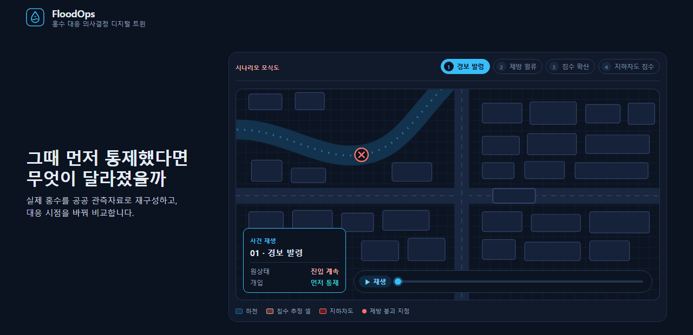
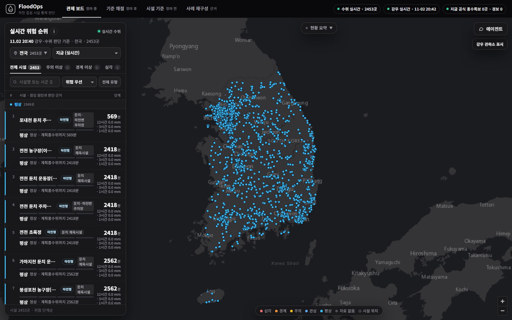
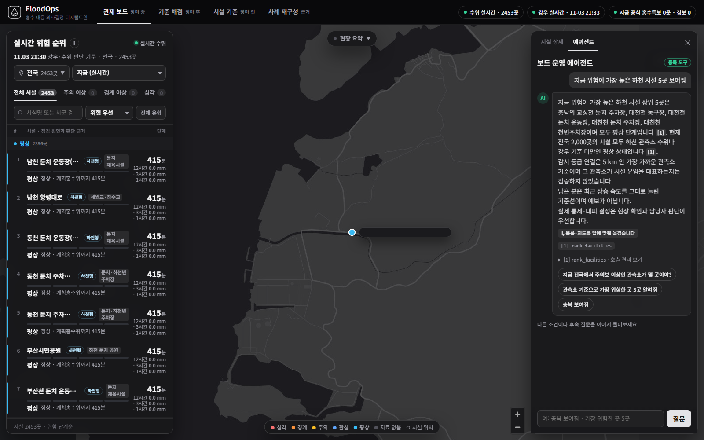
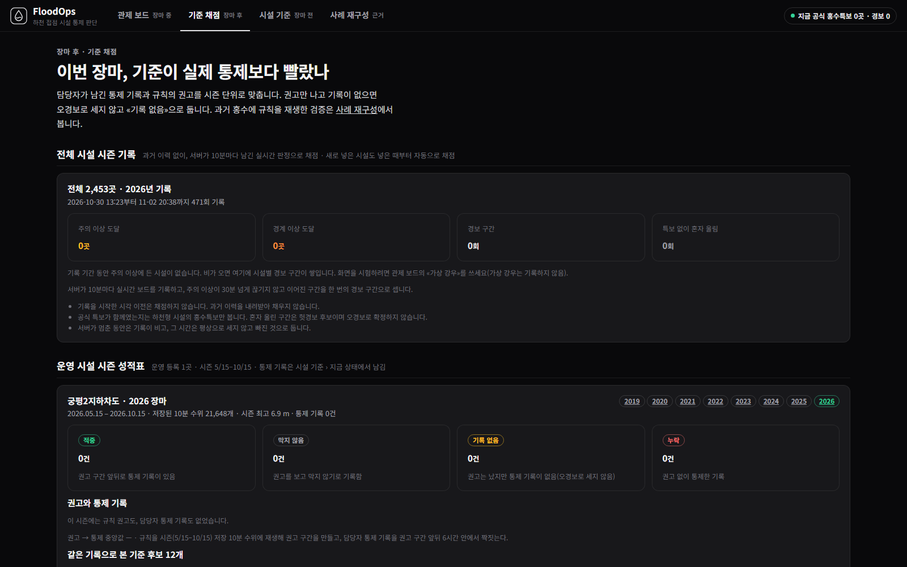
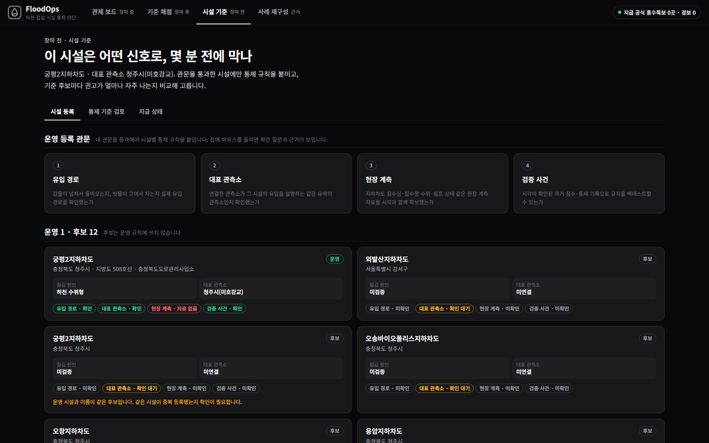
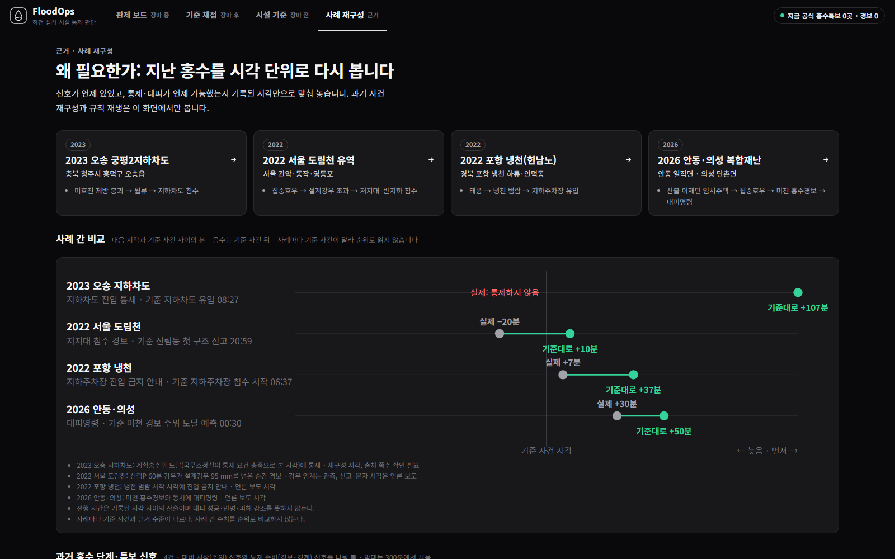
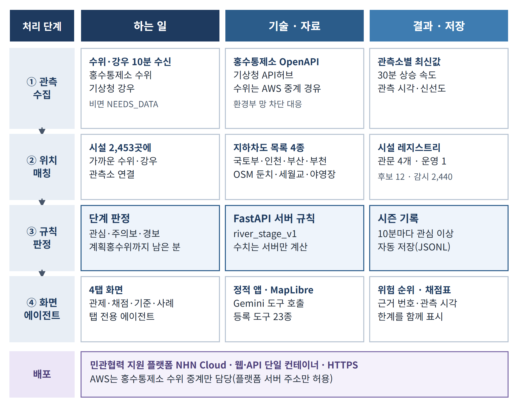

# FloodOps

<p align="center">
  <a href="https://floodops.duckdns.org/">
    
  </a>
</p>

<p align="center">
  <a href="https://floodops.duckdns.org/"></a>
  <a href="https://floodops.duckdns.org/docs"></a>
</p>

<p align="center">
  
  
  
  
  
  
  
  
</p>

**"이 지하차도, 지금 막아야 할까?"** 전국 하천 접점 시설(지하차도·둔치·세월교·하천변 야영장) **2,453곳**을 홍수통제소·기상청 실시간 관측으로 판정하고, 통제 검토 기준까지 몇 분 남았는지 보여주는 **홍수 대응 의사결정 디지털 트윈**입니다. 판정 규칙은 2023 오송 지하차도 참사 같은 과거 사건에 백테스트해 검증합니다. 통제 결정은 담당자가 하며, 트윈은 근거와 남은 시간을 보여줄 뿐 자동으로 차단하지 않습니다.

## 무엇을 만들었나

| | |
| --- | --- |
| **문제** | 2023 오송 지하차도 참사에서 하천 수위가 계획홍수위에 도달한 뒤에도 지하차도는 통제되지 않았습니다. 수위 정보는 있었지만 «이 시설을 지금 막아야 하는가»로 이어지지 않았습니다. |
| **해결** | 시설마다 가까운 수위·강우 관측소를 연결하고, 관측소의 공식 기준 수위(관심·주의보·경보·계획홍수위)와 상승 속도, 호우특보 기준 강우량으로 단계와 계획홍수위까지 남은 시간을 계산합니다. 같은 규칙을 과거 사건에 돌려 «몇 분 먼저 알 수 있었는가»를 채점합니다. |
| **규모** | 시설 2,453곳(지하차도 748·하천변 1,705), 수위 관측소 1,203곳·강우 628곳 실시간, 과거 사례 4건 재구성 |
| **개발** | 1인 개발 · 2026-08-30 ~ 진행 중 · 커밋 270개 이상 · 기획·데이터 수집·백엔드·프런트엔드·Agent·배포 전부 |
| **운영** | 민관협력 지원 플랫폼 NHN Cloud에서 실시간 운영 중(2026 AI·디지털 챌린지 출품작) |

## 화면

4개 탭이 장마 전·중·후 업무 순서를 따릅니다.

<table>
  <tr>
    <td colspan="2" align="center">
      <b>관제 보드</b> · 장마 중<br>
      <br>
      <sub>전국 시설의 실시간 위험 순위. 시설마다 판정 근거(수위·강우)와 계획홍수위까지 남은 분을 함께 보여줍니다.</sub>
    </td>
  </tr>
  <tr>
    <td width="50%" align="center" valign="top">
      <b>에이전트</b><br>
      <br>
      <sub>자연어 질문을 등록된 도구 호출로 바꾸고, 근거 번호와 함께 답합니다.</sub>
    </td>
    <td width="50%" align="center" valign="top">
      <b>기준 채점</b> · 장마 후<br>
      <br>
      <sub>판정 기준이 실제 사건보다 몇 분 먼저 알렸는지 채점합니다.</sub>
    </td>
  </tr>
  <tr>
    <td width="50%" align="center" valign="top">
      <b>시설 기준</b> · 장마 전<br>
      <br>
      <sub>시설마다 연결된 관측소와 통제 기준을 미리 점검합니다.</sub>
    </td>
    <td width="50%" align="center" valign="top">
      <b>사례 재구성</b> · 근거<br>
      <br>
      <sub>오송·서울·포항·안동 사례를 관측 자료로 단계별 재생합니다.</sub>
    </td>
  </tr>
</table>

## 기술적 도전과 해결

**1. 전국 관측소 실시간 수집을 호출 1회로**
관측소마다 API를 부르면 갱신 한 번에 1,400번 넘게 호출해야 합니다. 홍수통제소의 일괄 조회(`waterlevel/list/10M.json`)를 찾아 수위 1,203곳·댐 50곳·강우 628곳의 최신값을 호출 1회로 받고, 5분 캐시와 스냅샷을 두어 실시간 개요를 1.8초에 만들었습니다.

**2. 정부망 차단을 중계 서버로 우회**
플랫폼 서버(NHN Cloud)에서 위험도 응답이 25초 걸리고 관측 시각이 비었습니다. 처음엔 IP 차단으로 봤지만 공공데이터포털·기상청은 열리고 환경부 계열 도메인만 TCP 단계에서 끊기는 것을 확인해, 키 문제가 아니라 망 차단으로 좁혔습니다. AWS EC2의 Caddy에 플랫폼 서버 IP 하나만 허용하는 중계를 세워 연결했습니다(중계 0.5초).

**3. 시설×관측소 반복 탐색 제거**
시설이 2,453곳이 되자 위험도 API가 요청마다 평균 52.9초(응답 6.39 MB)를 썼습니다. 시설마다 강우 관측소 약 2,400곳을 매번 선형 탐색하던 O(시설×관측소) 반복이 원인이었습니다. 시설→10 km 안 관측소 목록을 한 번만 계산해 캐시하고, 서버 시작 때 백그라운드에서 미리 데워 첫 요청자가 비용을 떠안지 않게 했습니다.

**4. 600 MB 컨테이너 메모리 부족**
스왑 없는 600 MB 컨테이너가 첫 Agent 질문 때 종료(exit 137)됐습니다. 요청마다 최대 메모리를 재 보니 «지도 먼저 → 질문» 순서에서만 +100 MB가 튀었고, 같은 함수를 인자 유무만 다르게 부르는 두 호출이 `lru_cache(maxsize=1)`의 다른 키가 되어 약 140 MB 자료를 번갈아 다시 읽고 있었습니다. 캐시 키를 하나로 합쳐 상시 663 → 506 MiB로 줄였습니다.

**5. LLM Agent를 측정하며 개선**
모델이 분석값을 만들지 않고 등록된 도구만 고르도록 서버에서 도구명·입력값을 검증합니다. 7유형 고정 문항으로 «측정 → 원인 → 한 가지 변경 → 재측정»을 반복했습니다.

| 단계 | 바꾼 것 | 통과 | 모델 요청 · 토큰 |
| --- | --- | --- | --- |
| 기준선 | trace·39문항 도입 | 37/39 | 83 · 261,960 |
| 안정성 | 실패 도구 반복 차단, 근거 검사의 천 단위 표기 수정 | 39/39 | 67 (−19%) · 229,455 (−12%) |
| 시설 도구 확장 | 기준 비교·연구 모델 도구 (문항 43개) | 43/43 | 80 · 278,200 |
| 프롬프트 축소 | 도구 결과의 지도용 필드·카탈로그 중복 제외 | 43/43 | 80 · 218,766 (−21.4%) |

모델 `gemini-3.5-flash-lite`. 문항은 작성자가 고른 회귀 기준선이며 사용자 성공률이 아닙니다. 같은 프롬프트·도구·검증을 로컬 `qwen2.5:3b`(Ollama)에서도 돌려 11/13을 확인했습니다. 상세: [최적화 기록](docs/AGENT_OPTIMIZATION_LOG.md) · [평가 기록](docs/AGENT_EVALUATION_RESULTS.md)

## 구조

<p align="center">
  
</p>

| 영역 | 기술 | 선택 이유 |
| --- | --- | --- |
| 프런트엔드 | React 18 · TypeScript · Vite · MapLibre GL JS | 건물·도로·하천·시설 레이어를 GeoJSON 그대로 지도에 올려 벡터 타일 서버 없이 운영 |
| 백엔드 | FastAPI · Pydantic · Shapely | 요청·응답을 타입으로 선언해 Swagger를 자동 생성하고, 통제 시각·임계 같은 분석 입력을 서버가 검증 |
| Agent | Gemini REST(`httpx` 직접 호출) · Ollama | SDK 없이 호출해 도구 선택·검증 흐름을 직접 통제, 환경변수 한 줄로 로컬 모델 전환 |
| 테스트 | pytest · Vitest · Playwright | 백엔드 375개, E2E 8개 시나리오 파일(관제 보드·사례 재생·Agent 대화 등) |
| 배포 | Docker · Caddy · NHN Cloud · AWS EC2 | 웹·API 단일 컨테이너, HTTPS, AWS는 홍수통제소 API 중계만 담당 |

## 실행

4탭 앱과 API를 한 컨테이너로 띄웁니다(공개 서버와 같은 `Dockerfile.ops`).

```powershell
cp .env.example .env          # 홍수통제소·기상청·Gemini 키 (없으면 2023-07-15 재생 모드)
docker build -f Dockerfile.ops -t floodops:ops .
docker run --rm -p 8000:8000 --env-file .env floodops:ops
# 앱 http://localhost:8000  ·  Swagger http://localhost:8000/docs
```

```powershell
pip install -r backend/requirements.txt
python -m pytest backend/tests -q   # 375 passed (2026-11-03)
npm test
npx playwright install --only-shell chromium
npm run test:e2e
```

## 한계와 다음 단계

- 판정은 하천 수위·강우만 씁니다. 지하차도 침수심·진입차단시설 상태는 공개 실시간 API가 없어 기관 협력 과제로 남겨 두었습니다.
- 시설과 관측소 연결은 거리 기준이며, 관측소가 시설의 실제 수위를 대표하는지는 검증하지 않았습니다. 둔치 시설은 OSM 수면에서의 거리로 찾은 근사입니다.
- 과거 사건 백테스트는 2026년에 받은 보관 자료와 현재 기준값으로 계산했습니다. 예: 궁평2 규칙은 2023-07-15에 유입 157분 전 검토를 권했지만, 이는 백테스트 결과이지 실시간 경보 성능이 아닙니다.
- 사례 재생의 침수 범위는 지형(HAND) 기반 임시 근사이며, 공식 침수범위나 수리해석 결과가 아닙니다.

## 더 보기

- [사례 재생·지하차도 트윈 상세](docs/CASE_REPLAY.md) — 오송·서울·포항·안동 재생, 반사실 비교, Agent 범위, 주요 API
- [아키텍처](docs/ARCHITECTURE.md) · [데이터 가이드](docs/DATA_GUIDE.md) · [데이터 품질 기록](docs/data-quality.md) · [의사결정 기록](docs/DECISIONS.md)
- [시설 Agent](docs/FACILITY_AGENT.md) · [Agent 도구 계약](docs/AGENT_TOOL_CONTRACTS.md) · [작업 기록](WORKLOG.md)
